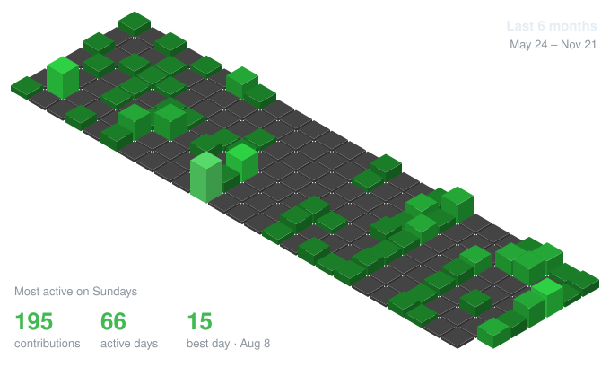

### | Systems Programming • Linux • Open Source |
> First-Year Computer Science Student @ JIIT Noida

### Currently

- Learning systems programming
- Solving problems on Codeforces and LeetCode
- Contributing to open source

### Tech Stack

**Languages**

  

**Tools & Environment**

  

  

  
  

  
  

  

## Featured Projects

* 🛵 [iQube Companion](https://github.com/Chetan-boi/iQube-companion) · [website](https://iqube-companion.chetan140209.workers.dev) - Your TVS scooter's battery, range and charging, live on your Mac
* 🛡️ [GitPurge](https://github.com/Chetan-boi/GitPurge) - Catches leaked API keys in VS Code before they get committed
* 🖥️ [ChSh](https://github.com/Chetan-boi/ChSh) - Unix-like shell in C++ with pipes, redirection and signal handling
* ✍️ [ScriptForge](https://github.com/Chetan-boi/scriptforge) - Turns typed notes into PDFs in your own handwriting
* ⚔️ [Hollowfied](https://github.com/Chetan-boi/hollowfied) *(WIP)* - Bleach-inspired top-down roguelike in Rust
* ⚡ [Binaries](https://github.com/Chetan-boi/Binaries) - Tools for scaffolding and running CMake projects
* 🧾 [QuickQuote](https://github.com/Chetan-boi/QuickQuote) - Offline app for GST-compliant quotation PDFs
* 🧮 [CalcX](https://github.com/Chetan-boi/CalcX) - qalc-style calculator for the terminal
* 🧠 [challoc](https://github.com/Chetan-boi/challoc) *(WIP)* - Memory allocator from scratch in C
* 📊 [Cstat](https://github.com/Chetan-boi/Cstat) *(WIP)* - Windows-style task manager for macOS, built with Dear ImGui

## 🌐 Connect

  
  
  
  

  

